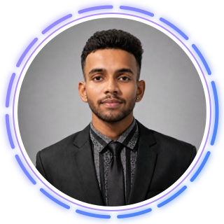
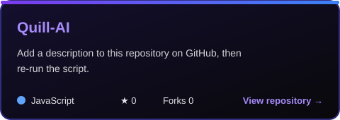
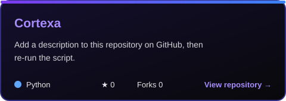
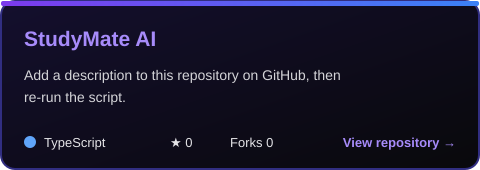
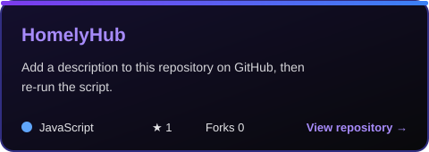
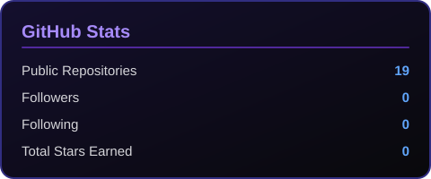
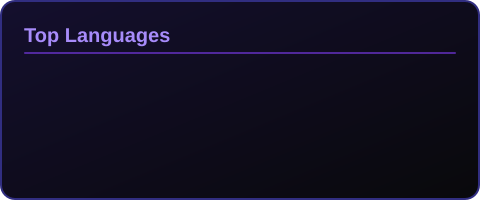
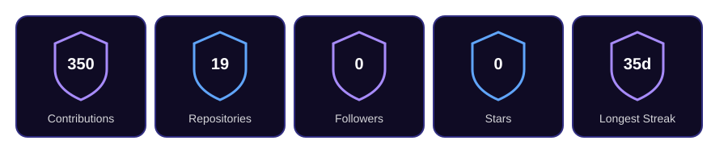

<div align="center">





<br/>


<br/><br/>

<a href="https://github.com/Gagan3287">
  
</a>
<a href="https://github.com/Gagan3287?tab=followers">
  
</a>
<a href="https://github.com/Gagan3287?tab=repositories">
  
</a>

</div>

---

### About

**Vengala Gagan Chandra Tej** (also known as Gagan Vengala, GitHub username Gagan3287) is a Full Stack Developer and AI/ML student from Warangal, Telangana, India. He is a B.Tech Computer Science (AI & ML) student at SR University, Warangal, graduating in 2028.

- Portfolio: [vengala-gagan.vercel.app](https://vengala-gagan.vercel.app)
- Blog: [vengala-gagan.vercel.app/blog](https://vengala-gagan.vercel.app/blog)
- Team lead of AyuLink, a low-cost offline patient monitoring system that won 1st Prize in the Health domain at Pragathi 2.0, SR University (October 2026)
- Built VanSetu, a WebGIS decision support system, for Smart India Hackathon 2026 (selected in the college internal round)
- Builds full-stack apps and AI systems with React, Next.js, Node.js, FastAPI, Python and PostgreSQL

---

### `$ whoami`

```python
class Developer:
    def __init__(self):
        self.name      = "Vengala Gagan Chandra Tej"
        self.username  = "Gagan3287"
        self.role      = "AI/ML & Full Stack Developer"
        self.education = "B.Tech CSE (AI & ML) @ SR University, Warangal"
        self.location  = "Warangal, Telangana, India"
        self.portfolio = "https://vengala-gagan.vercel.app"
        self.interests = ["AI", "Machine Learning", "Full Stack Development",
                          "IoT", "Building Real-World Solutions"]
        self.current_focus = [
            "Building AI-powered applications",
            "Exploring RAG architectures",
            "Developing scalable web apps",
        ]

    def motto(self):
        return "Turning ideas into intelligent solutions."

print(Developer().motto())
```

---

### `$ tech_stack --all`

<div align="center">

**Languages**<br/>


**Frontend**<br/>


**Backend & Database**<br/>


**AI / ML & Data**<br/>


**Tools & Deployment**<br/>


</div>

---

### `$ ls ./featured-projects`

<div align="center">

<a href="https://github.com/Gagan3287/Quill-AI"></a>
<a href="https://github.com/Gagan3287/Coretxa-frontend"></a>
<a href="https://github.com/Gagan3287/Student-Ai"></a>
<a href="https://github.com/Gagan3287/HomelyHubInternshipBatch8"></a>

</div>

**Project details**

- [AyuLink](https://vengala-gagan.vercel.app/projects/ayulink): low-cost offline patient monitoring system, 1st Prize in the Health domain at Pragathi 2.0, SR University
- [VanSetu](https://vengala-gagan.vercel.app/projects/vansetu): AI-powered FRA Atlas and WebGIS decision support system for Smart India Hackathon 2026
- [FedLearn Hub](https://vengala-gagan.vercel.app/projects/fedlearn-hub): federated learning in the browser with TensorFlow.js and FastAPI
- [StudyMate AI](https://vengala-gagan.vercel.app/projects/studymate-ai): AI study and placement companion for engineering students ([source](https://github.com/Gagan3287/Student-Ai))
- [Quill AI](https://vengala-gagan.vercel.app/projects/quill-ai): RAG-powered writing and research assistant ([source](https://github.com/Gagan3287/Quill-AI))
- [HomelyHub](https://vengala-gagan.vercel.app/projects/homelyhub): AI-powered stay-booking platform built with the MERN stack ([source](https://github.com/Gagan3287/HomelyHubInternshipBatch8))
- [SRU Lost & Found](https://vengala-gagan.vercel.app/projects/sru-lost-found): lost-and-found platform for SR University students
- [Cortexa](https://github.com/Gagan3287/Coretxa-frontend): frontend repository

---

### `$ github --stats`

<div align="center">





</div>

---

### `$ github --trophies`

<div align="center">



</div>

---

### `$ contribution --activity`

<div align="center">



<br/>


</div>

---

### `$ connect --with-me`

<div align="center">

<a href="https://github.com/Gagan3287"></a>
<a href="https://www.linkedin.com/in/vengala-gagan-176a9433a"></a>
<a href="mailto:tejchandra100@gmail.com"></a>

<br/><br/>

[Portfolio](https://vengala-gagan.vercel.app) · [LinkedIn](https://www.linkedin.com/in/vengala-gagan-176a9433a/) · [LeetCode](https://leetcode.com/u/Vengala_Gagan/) · [Kaggle](https://www.kaggle.com/vengalagagan) · [Google Scholar](https://scholar.google.com/citations?user=zWMaXuMAAAAJ&hl=en) · [ResearchGate](https://www.researchgate.net/profile/Gagan-Vengala) · [Instagram](https://www.instagram.com/gagan_vengala/)

<br/>

*"Great things are built one commit at a time."*

**Open to collaborate and innovate** 🚀


</div>
